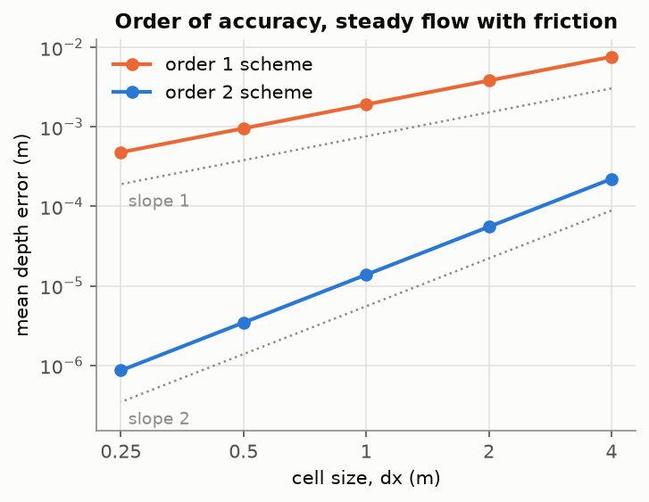
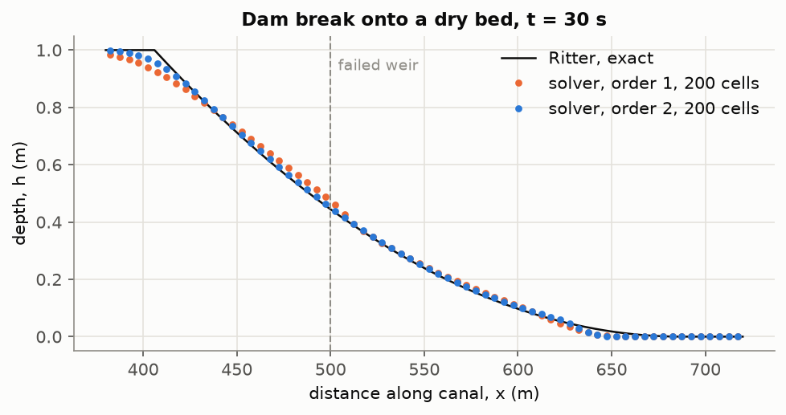
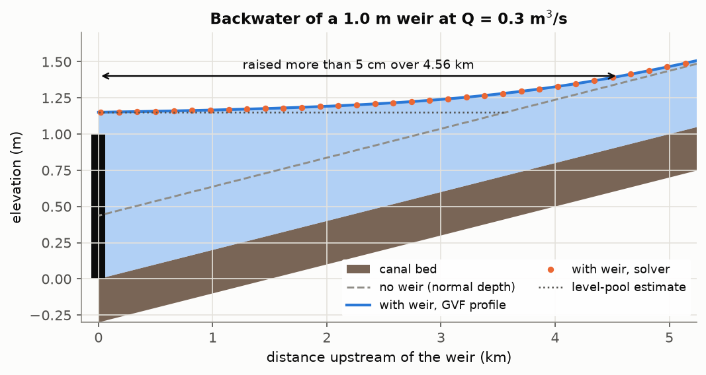
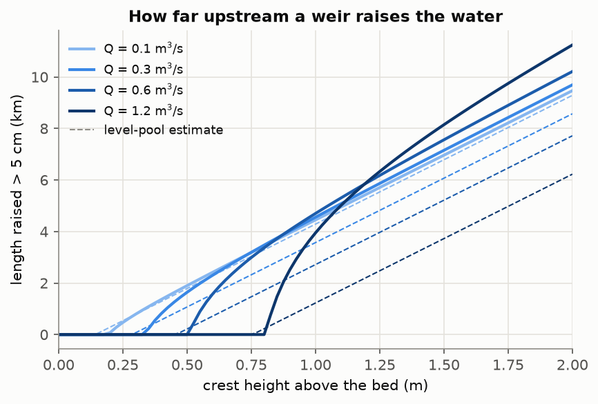
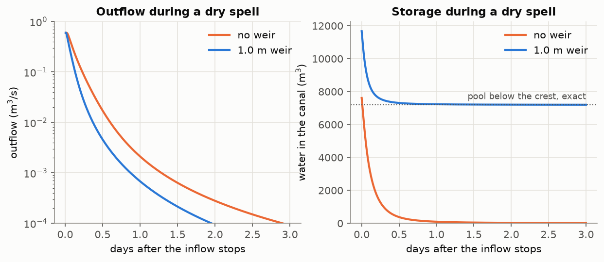

# Canal weirs

How far upstream does an overflow weir raise a peatland canal, and how does its outflow change as the level falls? A 1-D shallow-water solver, written from scratch and verified against exact answers.

Kalimantan peat · 01 of 11

## Setup

    git clone https://github.com/adibatic/kalimantan-peat-01-canal-weirs.git
    cd kalimantan-peat-01-canal-weirs
    conda env create -f environment.yml
    conda activate peat01
    python -m pip install --no-deps -e .
    pytest

## Environment

| Item | Value |
|---|---|
| OS | Microsoft Windows 11 Home Single Language |
| CPU | AMD Ryzen 7 6800HS Creator Edition |
| RAM | 28 GB |
| conda | 26.7.2 |
| Python | 3.14.8 |
| NumPy | 2.5.4 |
| SciPy | 1.18.1 |
| Matplotlib | 3.11.2 |
| pytest | 9.1.1 |

## Agent log

| Date | What the agent did wrong | How I caught it | Rule added to CLAUDE.md |
|---|---|---|---|

## Problem

A rectangular canal drains a peat dome. A fixed-crest overflow weir holds water back.

1. How far upstream does the weir raise the water? Measured as the length over which the depth is more than 5 cm above normal depth.
2. How does the outflow change as the level falls? With and without the weir, when the inflow stops.

The canal is chosen for illustration, not measured: width 3 m, bed slope 2e-4, Manning n = 0.03, discharges 0.1 to 1.2 m³/s, crests 0.5 to 1.5 m above the bed. Results are properties of this model canal, not of any real canal.

## Sources

☐ = equation not yet checked against my own copy; ☑ = checked.

| | Source | Used for |
|---|---|---|
| ☐ | Chow, V. T. (1959). *Open-Channel Hydraulics.* McGraw-Hill. | Manning's equation, critical flow, gradually varied flow, broad-crested weir |
| ☐ | Chaudhry, M. H. (2008). *Open-Channel Flow* (2nd ed.). Springer. | Saint-Venant equations, dam break |
| ☐ | Ritter, A. (1892). Die Fortpflanzung der Wasserwellen. *Zeitschrift des Vereines Deutscher Ingenieure* 36. | Dam break on a dry bed |
| ☐ | Delestre, O., et al. (2013). SWASHES. *Int. J. Numer. Meth. Fluids* 72(3), 269–300. doi:10.1002/fld.3741 | Ritter and MacDonald-type benchmarks |
| ☐ | MacDonald, I., et al. (1997). Analytic benchmark solutions for open-channel flows. *J. Hydraul. Eng.* 123(11). | Manufactured steady flow with friction |
| ☐ | Harten, A., Lax, P. D., van Leer, B. (1983). *SIAM Review* 25(1). | HLL flux |
| ☐ | Audusse, E., et al. (2004). *SIAM J. Sci. Comput.* 25(6). | Hydrostatic reconstruction |
| ☐ | Toro, E. F. (2001). *Shock-Capturing Methods for Free-Surface Shallow Flows.* Wiley. | MUSCL, minmod, wave speeds |

## Exact answers

| Check | Exact answer | Source |
|---|---|---|
| Lake at rest over a bump | velocity stays zero | definition |
| Volume | stored change = inflow - outflow | conservation of mass |
| Dam break onto a dry bed | Ritter's solution | Ritter 1892, SWASHES |
| Steady flow with friction | a chosen depth h(x); the bed derived from it | MacDonald et al. 1997, SWASHES |
| Order of accuracy | 1 (first-order scheme), 2 (second-order scheme) | the schemes' design |
| Weir at steady state | outflow = inflow, head = rating curve | weir law (Chow) |
| Backwater length | GVF integration from the weir upstream | Chow |
| Pool emptying over a weir | H(t) = H0 / (1 + C √H0 t / 2L)² | derived from the weir law |
| Pool kept below the crest | width × ∫ max(crest - z, 0) dx | geometry |

## Checks

A result is used only when all of these hold:

- pytest passes.
- Lake at rest over a bump: |q| and level error below 1e-12.
- Volume balance: relative error below 1e-13.
- Observed order on the steady benchmark: 1 ± 0.1 and 2 ± 0.1.
- Dam break, 200 cells: L1 depth error below 6 mm (order 1) and 3 mm (order 2).
- Steady runs stop at |dh/dt| below 1e-8 m/s; the solver's backwater length agrees with GVF within 1 %.

## Verification

Every check compares the solver with an exact answer, never with itself. pytest runs all of them.

| Check | Exact answer | Result | Criterion |
|---|---|---|---|
| Lake at rest over a bump | velocity stays 0 | below 1e-12 m²/s, both schemes | < 1e-12 |
| Volume, closed canal and two reaches with weirs | stored change = inflow - outflow | relative error below 1e-13 | < 1e-13 |
| Order of accuracy, steady flow with friction | manufactured depth h(x) | observed order 0.999 and 2.000 | 1 ± 0.1, 2 ± 0.1 |
| Weir fails onto a dry bed | Ritter's solution | L1 error 2.5 mm (order 2), 5.2 mm (order 1), 200 cells | < 3 mm, < 6 mm |
| Steady flow over a weir | outflow = inflow, head = rating curve | outflow within 1e-8 | 1e-8 |
| Backwater length | GVF integration | within 1 % | < 1 % |

The dam break converges at order 1.00 (second-order scheme) and 0.71 (first order), as expected for a solution with a kink and a dry front. Its volume drifts by 1e-16.

## Results

Length of canal raised more than 5 cm above normal depth upstream of one weir (GVF; the level-pool estimate in brackets). Illustrative canal: 3 m wide, slope 2e-4, n = 0.03.

| Discharge (m³/s) | Normal depth (m) | 0.5 m crest | 1.0 m crest | 1.5 m crest |
|---:|---:|---:|---:|---:|
| 0.1 | 0.215 | 1.90 km (1.79) | 4.45 km (4.29) | 6.96 km (6.79) |
| 0.3 | 0.437 | 1.64 km (1.07) | 4.56 km (3.57) | 7.15 km (6.07) |
| 0.6 | 0.696 | 0 (0.22) | 4.70 km (2.72) | 7.56 km (5.22) |
| 1.2 | 1.135 | 0 (0) | 3.95 km (1.23) | 8.15 km (3.73) |

The solver agrees with GVF within 5 m in all ten raised cases.

## Key finding

In the illustrative canal:

1. A weir only works if its crest plus its overflow head stands above the normal depth. A 0.5 m weir raises the water by more than 5 cm at 0.1 and 0.3 m³/s, but not at 0.6 m³/s or above.
2. Above that, every metre of crest raises roughly 5 km of canal (about 1/slope): 4.0 to 4.7 km for a 1.0 m weir across all four flows.
3. The level-pool estimate is within 6 % at 0.1 m³/s; at 0.3 to 1.2 m³/s the water is raised 1.2 to 3.2 times farther than it predicts.
4. After the inflow stops, a 4 km reach with a 1.0 m weir keeps 7,204 m³ after three days (the exact pool below the crest is 7,200 m³); without the weir, 14 m³.

These are properties of a model canal, not of any real canal, until it is surveyed and validated against field loggers.

## Progress

Self-paced. Target: the whole project in about a week.

- [x] Milestone 1: Foundation. The repository installs as a package, pytest runs, the rules are set.
- [x] Milestone 2: Problem defined. Question, sources, exact answers and checks written before any code.
- [x] Milestone 3: Hydraulics. Manning, critical depth and the weir law, tested.
- [x] Milestone 4: Exact answers. Ritter, a manufactured steady flow, the GVF profile and the pool drawdown, each tested against its equations.
- [x] Milestone 5: Solver. Well-balanced finite volumes, two schemes, weirs as boundaries, volume conserved.
- [x] Milestone 6: Verification. Observed orders 1 and 2, the dam break, the weir rating, the backwater length against GVF.
- [ ] Milestone 7: The answer. Backwater lengths, outflow as the level falls, the dry-spell recession.
- [ ] Milestone 8: Package the result. Animation, CI badge, front page, v1.0 release.